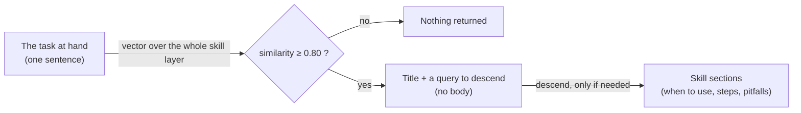

# Threshold Skills

**Don't list your skills. Let them light up.**

A way to keep dozens of working procedures ("skills") for an AI **without putting even a catalog of them in the prompt**.
Skills live in the same memory as conversations. A skill surfaces only when the question in front of the AI is close enough to it — and even then, only its title and a query to read it.

-yellow)

---

## The problem

Procedures pile up. How to publish a video, how to check a report, what never to touch. The common answers each cost something:

| Approach | Cost |
|---|---|
| **Write them all into the system prompt** | Every message pays for every procedure, relevant or not. |
| **Progressive disclosure (a catalog of names and descriptions, bodies on demand)** | Much better — but the catalog itself is loaded at the start of every session and grows with every skill. ([agentskills.io](https://agentskills.io/client-implementation)) |
| **Bundle skills into search results** | Tried it. Every search carries skill text along, and the tokens come back. |

## How it works

1. **Skills are crystals.** A skill is stored like any conversation crystal, in sections — and the first section says *when to wear it*.
2. **A threshold, not a ranking.** The question is compared with the whole skill layer. Below **0.80**, nothing comes back at all. So *getting a result is itself the signal* that a skill applies.
3. **Title only.** What comes back is the skill's title and the query that reads its sections. The body is read only if the AI decides to descend.
4. **Fire right before acting.** The search is made just before *making, fixing or deciding* — not while reading the past. **Reading is not wearing.**
5. **Once per conversation.** If the same skill lights up again in the same conversation, only its title is shown.

## What changed when we switched

- **2026-09-21** — the search that used to bundle skills was replaced; skills stopped being picked up at all. Instead of bundling them back, skill search became its own tool.
- **2026-10-24** — the 25-line skill catalog in the always-loaded profile was removed, after checking that every one of the 25 skills lights up **within the top 3** for its own task.
- **Today (2026-11-07)** — **75** active skills, and **zero** lines of skill catalog in the prompt.

## Compared with a catalog

| | Catalog + on-demand body | Threshold Skills |
|---|---|---|
| Loaded at session start | Name + description of every skill | Nothing |
| Grows with the number of skills | Yes | No |
| How a skill is chosen | The model reads the catalog and decides | Similarity to the task clears a fixed threshold |
| When nothing applies | Catalog is still in context | Search returns empty |
| Where the "when to use" lives | The description line | The skill's first section, read only on descend |

A catalog is easy to read and works well for a handful of skills. Threshold Skills is for when procedures keep accumulating and the prompt should not.

## What is (and isn't) here

This repository is a **dated public record of the design**. The implementation is not published.
To talk about building something like it, reach out through **[subtractlab.com](https://subtractlab.com)**.

**Related:** [MeaningSpace](https://github.com/subtractlab/meaningspace) (where the skills live) · [progress-map](https://github.com/subtractlab/progress-map)

---

Part of **[SubtractLab](https://github.com/subtractlab)** · Author: 奥田剛司 (Koji Okuda) · [subtractlab.com](https://subtractlab.com) · 日本語: [README.ja.md](README.ja.md)
